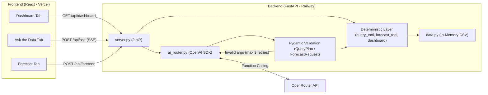
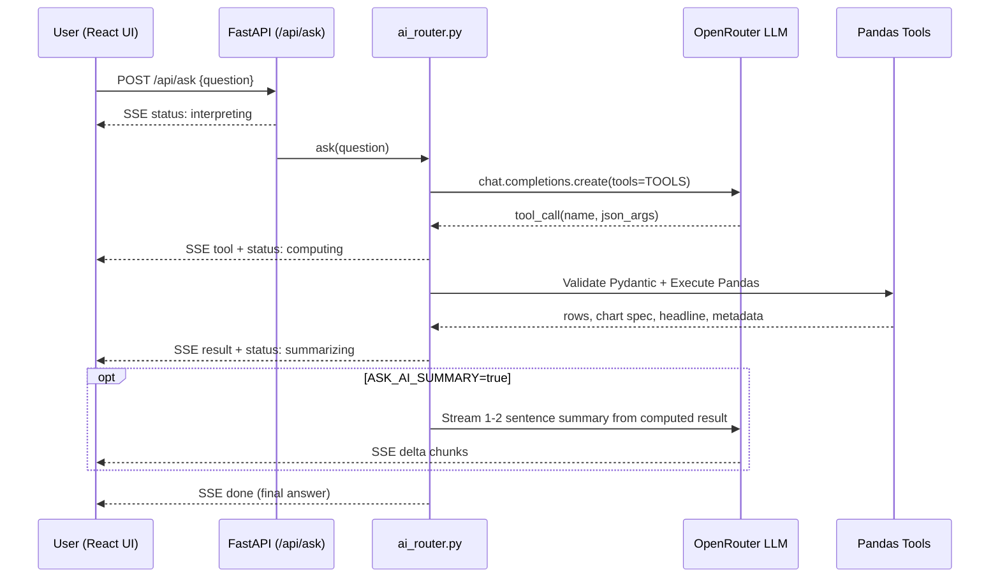
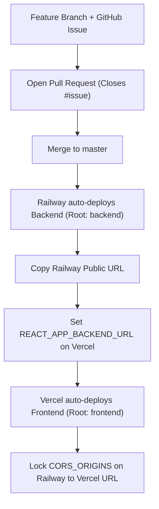

# Logistics Analytics Copilot

A full-stack logistics analytics application with a KPI dashboard, a natural-language "Ask the Data" interface, and demand forecasting with safety-stock recommendations. All computations run on `backend/data/mock_logistics_data.csv` (400 orders from 2025).

**Core principle:** The LLM only *interprets* natural-language questions and routes them to typed backend tools with structured JSON arguments. Every metric, chart, and forecast is computed deterministically by Python/Pandas code, and every answer includes explainability metadata showing how the result was produced.

**Live Demo:** https://spaceship-theta.vercel.app

## Documentation Index

- **Root Overview (this file):** Architecture, local setup, forecasting methodology, and production deployment.
- **Backend Documentation:** [`backend/README.md`](backend/README.md) — API endpoints, AI routing pipeline, environment variables, tests, and Railway deployment.
- **Frontend Documentation:** [`frontend/README.MD`](frontend/README.MD) — React structure, component flow, environment variables, build commands, and Vercel deployment.

---

## 1. Tech Stack

- **Frontend:** React 19, CRACO, Tailwind CSS, shadcn/ui, Recharts, TanStack Query
- **Backend:** Python 3.10+, FastAPI, Uvicorn, Pandas, NumPy, Pydantic
- **AI Routing:** OpenRouter (or any OpenAI-compatible provider) via the official `openai` Python SDK with function calling
- **Data:** `backend/data/mock_logistics_data.csv` loaded once into memory as read-only
- **Deployment:** Frontend on Vercel, Backend on Railway

---

## 2. System Architecture



### Ask the Data Flow (SSE)



### Key Design Decisions

- **No AI-generated SQL:** The model populates a strict, typed `QueryPlan` or `ForecastRequest`. Unsupported requests are routed to `decline_question`.
- **In-memory Pandas:** 400 rows load instantaneously without database operational overhead.
- **Deterministic chart selection:** Chart type is selected by backend code based on result shape (single value -> KPI card, time series -> line, time x dimension -> multi-line, small additive breakdown <= 6 groups -> donut, otherwise horizontal bar).
- **Caching and history:** Identical normalized questions are replayed from an in-memory backend cache; session query history is persisted in browser `localStorage`.

---

## 3. Local Setup

### Backend

```bash
cd backend
pip install -r requirements.txt
cp .env.example .env
# Edit backend/.env and fill LLM_API_KEY and LLM_MODEL
uvicorn server:app --host 0.0.0.0 --port 8001 --reload
```

### Frontend

```bash
cd frontend
yarn install
cp .env.example .env
# Default REACT_APP_BACKEND_URL=http://localhost:8001
yarn start
```

### Environment Variables

| Variable | Location | Purpose |
|---|---|---|
| `LLM_BASE_URL` | `backend/.env` | OpenAI-compatible API base URL (default: `https://openrouter.ai/api/v1`) |
| `LLM_API_KEY` | `backend/.env` | OpenRouter (or compatible provider) API key. If empty, Dashboard and Forecast continue working while Ask shows AI unavailable. |
| `LLM_MODEL` | `backend/.env` | Model ID on OpenRouter (e.g. `anthropic/claude-sonnet-5.5`, `openai/gpt-4o-mini`) |
| `ASK_AI_SUMMARY` | `backend/.env` | `false` (default) uses the deterministic headline; `true` runs a second streaming call to summarize the computed result |
| `CORS_ORIGINS` | `backend/.env` | Comma-separated allowed origins (`*` for local development, production Vercel URL in production) |
| `REACT_APP_BACKEND_URL` | `frontend/.env` | Base URL of the backend API without a trailing slash (read at build time) |

### Running Tests

```bash
cd backend
pytest test/test_tools.py -q
```

---

## 4. Forecasting Method

- **Demand definition:** Monthly sum of `quantity`, excluding orders with status `canceled`.
- **Granularity:** Product category or total demand. A SKU is forecast individually only if it has demand in at least 6 of 12 months; otherwise it falls back to its product category with an explicit note.
- **Candidate models:** Linear regression on month index vs. 3-month moving average.
- **Selection:** Rolling one-step-ahead back-test starting from month 4; the model with lower MAE is selected.
- **Uncertainty and stock recommendation:**
  - Range: `forecast +/- 1.65 * sigma` (where `sigma` is the standard deviation of back-test residuals).
  - Safety stock: `1.65 * sigma * sqrt(horizon)` (~95% service level).
  - Recommended stock: `forecast_total + safety_stock`.

---

## 5. Production Deployment (Railway + Vercel)

Both platforms are connected to GitHub (`master` branch) for Continuous Deployment (CD).



### Deployment Order

1. **Deploy Backend on Railway first:**
   - Root Directory: `backend` (uses `backend/railway.json`)
   - Start Command: `uvicorn server:app --host 0.0.0.0 --port $PORT`
   - Healthcheck Path: `/api/`
   - Set `LLM_BASE_URL`, `LLM_API_KEY`, `LLM_MODEL`, `ASK_AI_SUMMARY`, and `CORS_ORIGINS=*` (temporarily).
   - Generate a public domain on target port `8080` and verify `GET /api/` and `GET /api/meta`.
2. **Deploy Frontend on Vercel:**
   - Root Directory: `frontend` (uses `frontend/vercel.json`)
   - Build Command: `yarn build`, Output Directory: `build`
   - Set `REACT_APP_BACKEND_URL=https://<your-railway-domain>` (no trailing slash).
3. **Lock CORS on Railway:**
   - Update `CORS_ORIGINS` on Railway from `*` to your production Vercel URL (e.g. `https://your-app.vercel.app`).

---

## 6. Assumptions and Limitations

- **Reference date:** `"Today"` is fixed to `2025-12-31` (end of dataset). Relative terms such as "last month" resolve to November 2025.
- **Status-based metrics:** `on_time_rate = delivered / (delivered + delayed)`. `exception`, `in_transit`, and `canceled` are counted in `order_count` but excluded from on-time/delay rates.
- **Single-turn Ask:** Each question is evaluated independently without multi-turn conversation state.
- **Unsupported queries:** Causal questions not in the dataset (weather, traffic), costs/SLA columns not present in CSV, years outside 2025, and data modification requests are declined with suggested alternatives.
