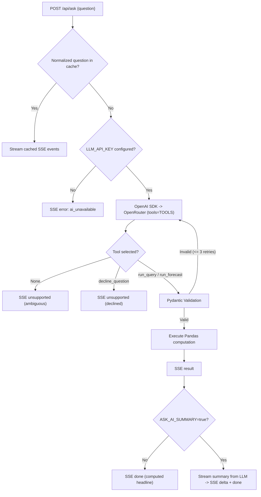

# Backend — Logistics Analytics Copilot

FastAPI backend serving KPI aggregations, deterministic query execution, demand forecasting, and LLM-routed analytics over `data/mock_logistics_data.csv`.

## Directory Structure

```text
backend/
├── analytics/
│   ├── ai_router.py       # OpenRouter / OpenAI-compatible tool routing and SSE generator
│   ├── dashboard.py       # Dashboard KPI and chart series aggregation
│   ├── data.py            # CSV loader, metric definitions, reference date, shared filters
│   ├── forecast_tool.py   # Rolling back-test model selection and safety stock computation
│   └── query_tool.py      # Pydantic QueryPlan validation, Pandas execution, chart selection
├── data/
│   └── mock_logistics_data.csv
├── test/
│   ├── test_tools.py      # Deterministic computation unit tests (no LLM calls)
│   └── test_api_endpoint.py
├── .env.example
├── pytest.ini
├── railway.json           # Railway build, start command, and healthcheck config
├── requirements.txt
└── server.py              # FastAPI app and /api router
```

---

## Request Flow (`/api/ask`)



---

## API Endpoints

| Method | Path | Description |
|---|---|---|
| `GET` | `/api/` | Healthcheck endpoint, returns `{"status": "ok"}` |
| `GET` | `/api/meta` | Dataset bounds, allowed filter values, metric definitions, `ai_available`, and example prompts |
| `GET` | `/api/dashboard` | Filtered KPIs and chart series (`start`, `end`, `carrier`, `region` query params) |
| `POST` | `/api/query` | Direct deterministic query execution accepting a `QueryPlan` JSON body |
| `POST` | `/api/forecast` | Demand forecast and stock recommendation accepting a `ForecastRequest` JSON body |
| `POST` | `/api/ask` | Natural-language question routed by LLM, streamed as Server-Sent Events (`text/event-stream`) |

---

## Environment Variables

Copy `.env.example` to `.env` in `backend/`:

| Variable | Required | Default | Description |
|---|---|---|---|
| `LLM_BASE_URL` | No | `https://openrouter.ai/api/v1` | OpenAI-compatible API base URL |
| `LLM_API_KEY` | For `/api/ask` | *(empty)* | API key for OpenRouter or compatible provider |
| `LLM_MODEL` | No | `anthropic/claude-sonnet-5.5` | Model identifier supporting function calling |
| `ASK_AI_SUMMARY` | No | `false` | Set `true` to generate a natural-language summary from computed results |
| `CORS_ORIGINS` | No | `*` | Comma-separated allowed origins |
| `OPENROUTER_SITE_URL` | No | *(empty)* | Optional `HTTP-Referer` header for OpenRouter rankings |
| `OPENROUTER_APP_NAME` | No | *(empty)* | Optional `X-Title` header for OpenRouter rankings |

Note: `ai_router.py` calls `load_dotenv(..., override=True)`, so updates to `backend/.env` are picked up without restarting `uvicorn`.

---

## Local Development and Testing

```bash
cd backend
pip install -r requirements.txt
cp .env.example .env
uvicorn server:app --host 0.0.0.0 --port 8001 --reload
```

Run deterministic unit tests:

```bash
cd backend
pytest test/test_tools.py -q
```

---

## Deployment on Railway

1. Connect the GitHub repository on Railway and set **Root Directory** to `backend`.
2. `backend/railway.json` configures Nixpacks, start command (`uvicorn server:app --host 0.0.0.0 --port $PORT`), and healthcheck (`/api/`).
3. Add the environment variables (`LLM_BASE_URL`, `LLM_API_KEY`, `LLM_MODEL`, `ASK_AI_SUMMARY`, `CORS_ORIGINS`) in Railway **Variables**.
4. Under **Settings -> Networking -> Public Networking**, generate a domain targeting port `8080`.
5. Verify `GET https://<your-railway-domain>/api/` returns `{"status":"ok"}` and `GET https://<your-railway-domain>/api/meta` returns `"ai_available": true`.
6. Once the frontend is live on Vercel, set `CORS_ORIGINS` to the exact Vercel URL (without a trailing slash).
