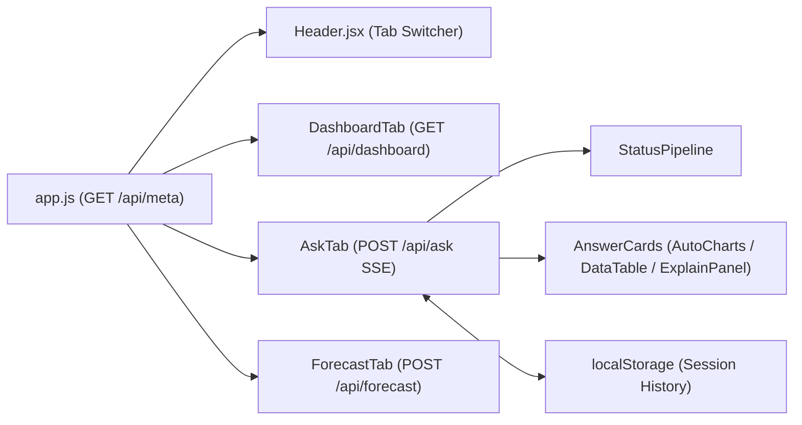

# Frontend — Logistics Analytics Copilot

React 19 single-page application providing the KPI Dashboard, Ask the Data (SSE streaming), and Demand Forecast views.

## Tech Stack

- **Framework:** React 19 with CRACO (`@craco/craco` + `react-scripts`)
- **Styling and UI:** Tailwind CSS, shadcn/ui (Radix UI primitives), Lucide icons
- **Charts:** Recharts
- **Data Fetching:** Axios (REST), native Fetch ReadableStream (SSE), TanStack Query

---

## Directory Structure

```text
frontend/
├── public/
│   └── index.html
├── src/
│   ├── components/
│   │   ├── Header.jsx              # Top navigation bar and dataset metadata badge
│   │   ├── ask/                    # AskTab, AnswerCards, DataTable, ExplainPanel, StatusPipeline
│   │   ├── charts/                 # AutoCharts, ChartsParts (dynamic chart renderer)
│   │   ├── dashboard/              # DashboardTab, FilterBar, KpiGrid, DashboardCharts
│   │   ├── forecast/               # ForecastTab, ForecastView
│   │   └── ui/                     # shadcn/ui reusable primitives
│   ├── hooks/
│   ├── lib/
│   │   ├── api.js                  # REST and SSE client targeting REACT_APP_BACKEND_URL
│   │   ├── format.js               # Number, currency, date, and metric formatters
│   │   └── utils.js
│   ├── app.js                      # Root shell managing active tab and /api/meta state
│   └── index.js
├── .env.example
├── craco.config.js                 # Path alias (@ -> src) and webpack-dev-server v5 compatibility
├── jsconfig.json
├── package.json
└── vercel.json                     # Vercel build and SPA rewrite configuration
```

---

## Frontend Data Flow



---

## Environment Variables

Copy `.env.example` to `.env` in `frontend/`:

| Variable | Required | Default | Description |
|---|---|---|---|
| `REACT_APP_BACKEND_URL` | Yes (in production) | `http://localhost:8001` | Base URL of the FastAPI backend without a trailing slash |

Important: Create React App / CRACO embeds `REACT_APP_*` variables at **build time**. Any change to `REACT_APP_BACKEND_URL` requires a rebuild or redeploy.

---

## Local Development and Build

```bash
cd frontend
yarn install
cp .env.example .env
yarn start
```

The development server runs at `http://localhost:3000`.

Production build:

```bash
cd frontend
yarn build
```

---

## Deployment on Vercel

1. Import the GitHub repository on Vercel and set **Root Directory** to `frontend`.
2. `frontend/vercel.json` defines `buildCommand` (`yarn build`), `outputDirectory` (`build`), and SPA rewrites.
3. Add the environment variable `REACT_APP_BACKEND_URL` set to your Railway backend URL (for example `https://your-backend.up.railway.app`, without a trailing slash).
4. Deploy. Future merges to `master` will trigger automatic redeployment (CD).
